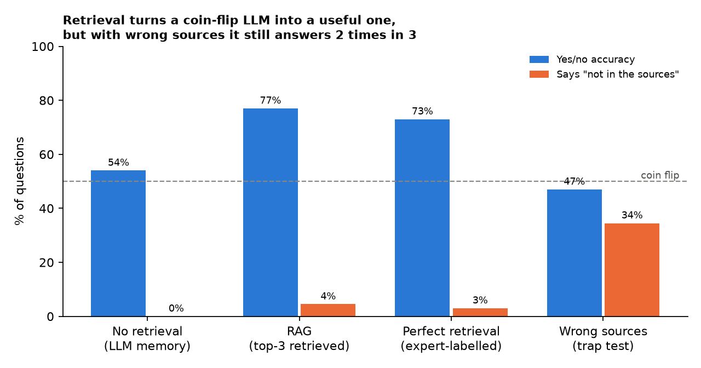

# Biomedical Q&A with RAG: Does Retrieval Make a Small LLM Trustworthy?

A retrieval-augmented generation (RAG) system that answers biomedical research questions from 28,000 PubMed abstracts, using a **small open LLM that runs locally** (Qwen2.5-1.5B, no API cost). The focus is **evaluating the answers**, not just building the pipeline: is the model more correct with retrieval, does it stick to its sources, and does it admit when the sources do not contain the answer?

    



## Data

[BioASQ mini RAG dataset](https://huggingface.co/datasets/rag-datasets/rag-mini-bioasq): PubMed abstracts plus questions written by biomedical experts, each with a reference answer and the ids of the relevant abstracts.

**Cleaning:** 12,278 of 40,221 passages (30%) were empty (`"nan"`) or under 20 words and were removed, leaving **27,943 abstracts**. Questions that lost all their evidence passages were dropped, leaving 4,386.

**Evaluation sample:** 200 questions: 50 with answer "yes", 50 "no" and 100 open questions. "Yes" outnumbers "no" 3:1 in the data, so the sample is balanced; otherwise a model that always says "yes" would look 75% accurate.

## Experiment: the same 200 questions in 4 settings

| Setting | What the LLM gets |
|---|---|
| No retrieval | only the question (answers from its own memory) |
| **RAG** | the top-3 abstracts from the retriever |
| Perfect retrieval | 3 abstracts that experts labelled as relevant (upper bound for retrieval) |
| Wrong sources (trap test) | the top-3 abstracts for a *different* question. The right behaviour is "The sources do not contain the answer." |

## Results

| Metric | No retrieval | **RAG** | Perfect retrieval | Wrong sources |
|---|---|---|---|---|
| Yes/no accuracy (50% = coin flip) | 54% | **77%** | 73% | 47% |
| Similarity to expert answer | 0.63 | **0.71** | 0.68 | 0.54 |
| Says "not in the sources" | 0% | 4.5% | 3% | 34.5% |
| Answers that cite a source | - | 30% | 23% | 10% |
| Invalid citations (e.g. [5] when there are 3 sources) | - | 0% | 0% | 0% |

Retrieval quality on all 4,386 questions: a relevant abstract is ranked first for 73% of questions, and is in the top 3 for 85% (top 10: 91%).

**Key findings**

1. **Without retrieval, the 1.5B model is a coin flip on biomedical yes/no questions (54%).** With RAG it reaches **77%**. The knowledge is in the documents, not in the small model.
2. **The retriever is good enough.** RAG did as well as the expert-labelled "perfect" abstracts (77% vs 73%, within noise for 100 questions). The retriever ranks abstracts by similarity to the question, which often surfaces the most directly relevant one. Improving retrieval is not the next priority here.
3. **The main risk is over-confidence.** Given sources about a different topic, the model admitted "the sources do not contain the answer" only **35% of the time**. In the other 65% it answered anyway from memory, at coin-flip accuracy (47%). In a medical setting this is the failure to fix first.
4. **Small models follow formatting instructions weakly.** Only 30% of RAG answers include a citation, even though the prompt requires one. All citations that were given were valid.

## Faithfulness check, and its limits

Each answer sentence was checked against the sources with an NLI (natural-language-inference) model (`cross-encoder/nli-deberta-v3-xsmall`): a sentence counts as supported only if the model says a source *entails* it.

| | No retrieval | RAG | Perfect retrieval | Wrong sources |
|---|---|---|---|---|
| Answers fully supported by the sources | 9% | 21% | 21% | 0% |

The direction is as expected (no support for wrong sources, more with RAG). But spot checks show that **this check is too strict**: correct paraphrases are often marked "not supported" (e.g. *"Nanog, Pou5f1 (Oct4), and SoxB1 regulate zygotic gene activation"*, which matches the expert answer, scored 0). Read these numbers as a lower bound, not as hallucination rates. A larger NLI model or an LLM judge with human spot checks would be the next step.

## How it works

```
question ──► bge-small embedding ──► cosine search over 27,943 cached abstract vectors ──► top-3 abstracts
                                                                                             │
          Qwen2.5-1.5B-Instruct (local, greedy decoding = repeatable answers)  ◄── numbered sources + rules:
                                                                                use only sources, cite [n],
                                                                                say "not in the sources" if absent
```

- [`src/data.py`](src/data.py) - download, cleaning, balanced evaluation sample
- [`src/retriever.py`](src/retriever.py) - dense retrieval with an embedding cache; each abstract is one chunk (abstracts are short and self-contained)
- [`src/generator.py`](src/generator.py) - prompts and local LLM generation
- [`src/metrics.py`](src/metrics.py) - yes/no accuracy, similarity, NLI faithfulness, citation and abstention checks (unit-tested)
- [`src/evaluate.py`](src/evaluate.py) - runs the 4 settings, resumes if interrupted, saves every answer
- [`reports/scored_answers.csv`](reports/scored_answers.csv) - all 800 generated answers with their scores, for manual review

## How to run

```bash
python -m venv .venv && source .venv/bin/activate
pip install -r requirements.txt
python -m src.evaluate   # downloads data + models (~3.5 GB), 800 generations (~1.5 h on an Apple M2 laptop)
python -m src.report     # chart
pytest -q                # 7 tests
```

No API key is needed: everything runs locally. Runs on Apple Silicon (MPS), NVIDIA (CUDA) or CPU.

## Next steps

- Fix over-confidence: add a relevance check before generation (skip the LLM when the best retrieval score is low) and test a larger model (7-8B).
- Replace the strict NLI check with an LLM judge, validated against ~50 human-labelled answers.
- Evaluate the open questions with expert-style grading instead of embedding similarity.
